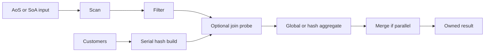

# VQuery

A C++20 query engine for measuring how row layout, batch execution, and parallelism affect filtering, aggregation, and hash joins on one machine.

All three engines run all three queries, including batch execution with 1, 2, or 4 threads. The repository includes a deterministic generator, independent result checks, memory accounting, and a benchmark runner. The controlled Linux performance study and final report are still pending. See [performance work](docs/performance.md) and [test coverage](docs/testing.md).

## Build and run

Requirements: CMake 3.25+, Ninja, Python 3.11+, and a C++20 compiler and standard library with `std::jthread`. CI uses GCC 13 and Clang 18 on Linux, and Apple Clang on macOS 26. CMake checks library support at configuration time. GoogleTest is pinned by version and archive SHA-256 in `cmake/Dependencies.cmake`; the first test build downloads it.

```bash
cmake --preset debug
cmake --build --preset debug --parallel 4
ctest --preset debug --parallel 4

./build/debug/vquery --query group-sum --engine batch-soa \
  --rows 10000 --groups 1024 --cutoff 5000 --format json
```

Use `release` in place of `debug` for measurements. The `asan-ubsan` and `tsan` presets build separate sanitizer configurations. All presets enable tests; Debug and Release clear the sanitizer option when reconfiguring an existing build directory. Linux CI runs both sanitizer suites.

A small benchmark exercises all query/engine combinations, including parallel execution:

```bash
python3 scripts/run_bench.py --manifest bench/manifests/smoke.json \
  --build-dir build/debug --output-dir results/local/smoke --exploratory
```

Choose a new output directory for each run. The smoke manifest uses no warmups and four samples; its results check the workflow rather than establish performance.

## Scope

VQuery executes three fixed plans over generated, memory-resident data. It has no SQL parser, optimizer, persistence, transactions, network service, or file ingestion. Inputs are read-only. Types are fixed-width integers; NULLs, strings, floating-point values, composite keys, outer joins, and many-to-many joins are outside this version.

The project is intended to answer:

- How much does row versus column storage matter under the same row execution model?
- What changes when column operators process batches instead of one row per call?
- How do selectivity, group cardinality, skew, and join build size affect cost?
- When does parallel work pay for thread startup and merging?

Completion requires reproducible measurements and an explanation of the results, including regressions. It does not require a particular speedup. SIMD intrinsics, JIT compilation, disk spilling, a scheduler, and Rust KV integration are possible later projects.

## Engines

| CLI name | Storage | Processing | Threads |
| --- | --- | --- | --- |
| `row-aos` | Array of row structs | `next(Row&)` | 1 |
| `row-soa` | One contiguous array per column | `next(Row&)` | 1 |
| `batch-soa` | Same column layout | `next(Batch&)` | 1, 2, 4 |

`row-aos` and `row-soa` share row operators except Scan. All engines share hash tables, aggregate state, query semantics, and build settings. The default batch size is 2048; supported sizes are 256, 512, 1024, 2048, 4096, and 8192.

Compare `row-aos` against `row-soa` for layout, then `row-soa` against `batch-soa` for batching. The latter also changes when values are loaded and copied: row Scan materializes query fields, while batch Scan exposes column views. Batch execution does not by itself establish SIMD execution. Parallel scaling is a separate comparison against single-threaded `batch-soa`.

## Data and queries

| Table | Fields |
| --- | --- |
| `facts` | `customer_id: uint32`, `group_id: uint32`, `amount: int64`, `score: uint32` |
| `customers` | `customer_id: uint32`, `region_id: uint32` |

Limits are 100 million fact rows, 10 million dimension rows, amounts in `[0, 1,000,000]`, scores in `[0, 9999]`, and regions in `[0, 15]`. The generator supports 1–1,000,000 group keys. Fixtures can use any `uint32` customer/group key, including `UINT32_MAX`. Counts use `uint64` and sums use `int64`; the largest supported sum is `10^14`.

All four fact columns exist in every layout. Only the join query allocates customers. Generated inputs use independent `mt19937_64` streams and rejection sampling so layout, compiler, or skew changes do not shift unrelated columns. The same seed and logical parameters produce the same values across engines. `hot-key-90` gives key zero a 90% probability in Q2 groups or Q3 matching customer keys. With a single key, every applicable row uses it. Exact stream and checksum rules are in [decisions.md](docs/decisions.md).

The SQL describes semantics; the CLI selects plans by name.

**Q1: `filter-sum`** — Scan → Filter → global aggregate.

```sql
SELECT COUNT(*), COALESCE(SUM(amount), 0)
FROM facts WHERE score < :cutoff;
```

**Q2: `group-sum`** — Scan → Filter → hash aggregate.

```sql
SELECT group_id, COUNT(*), SUM(amount)
FROM facts WHERE score < :cutoff
GROUP BY group_id;
```

**Q3: `join-group-sum`** — serial customer hash build, then Scan → Filter → join probe → hash aggregate.

```sql
SELECT c.region_id, COUNT(*), SUM(f.amount)
FROM facts f JOIN customers c ON f.customer_id = c.customer_id
WHERE f.score < :cutoff
GROUP BY c.region_id;
```

A cutoff of zero rejects all rows; 10000 accepts all. Q1 always returns one row, with zero count/sum for empty input. Q2/Q3 return only surviving groups, so empty input produces no rows. Repeated fact keys are allowed; unmatched facts are discarded. Duplicate customer keys fail during build, even with no facts or cutoff zero. An empty dimension requires a zero generated match rate.

The query result owns its rows. Group order is unspecified inside the engine; the CLI sorts by key outside query timing. JSON result rows contain `key`, `count`, and `sum`, with `key: null` for Q1. Errors go to stderr as JSON and return a nonzero exit status.

## Implementation



The entry point is `execute(QuerySpec, const Tables&, ExecutionContext&)`. It creates fresh state for each query and releases intermediate buffers before returning. Generation and fixture value validation happen during input preparation. Configuration, budget identity, and column lengths are also checked before execution creates views.

Row and batch sources expose `open`, `next`, and `close`. A successful batch contains at least one logical row; Filter and Join skip empty intermediate batches. Scan borrows column spans, Filter owns selection indices, and Join compacts matches into its own key/amount buffers. A batch view lasts until the source's next `next` or `close` call. Parents consume it before advancing. `close` is idempotent and safe after partial `open`; destruction also releases resources.

Selections contain physical positions in the original batch. Chained filters follow existing selections rather than treating their indices as dense rows. Unique build keys ensure a B-row probe needs at most B output slots. No full filtered or joined table is materialized.

The shared hash table uses separate key, value, and occupancy arrays, linear probing, power-of-two capacity, and a maximum load of 0.70. No key is reserved as an empty sentinel. Group tables start at 1024 slots and grow only for a new key. Join capacity is reserved from the dimension row count. Hashing is independent of the input seed. All engines use this implementation; reference tests use standard containers and nested loops.

With multiple threads, each worker gets a contiguous fact range, its own pipeline, and a local aggregate. Q3 shares an immutable join table built by the caller. The caller joins workers and merges their states. Workers have separate error slots and share a stop source, checked between batches. A failure cancels remaining work and discards partial results. Thread creation, joining, and merging are included in query time. With one thread, execution stays on the caller.

The default managed-buffer limit is 4096 MiB. A counting allocator reserves bytes before allocation and releases them on deallocation. Input, hash slots, batch buffers, results, and concurrent worker buffers share that limit. Old and new buffers both count during growth. Copying an owning table also copies its buffers into the source budget; failed copy assignment leaves the destination unchanged. Individual `Buffer` copy assignment retains its destination allocator. Results keep their budget alive after input/context destruction.

The limit is not an RSS cap: thread stacks, small control objects, allocator bookkeeping, and Python/JSON memory are excluded. Query peaks reset only after previous result buffers have been released. Allocation failures produce errors, never partial success.

## Source map

| Path | Responsibility |
| --- | --- |
| `include/vquery/common/`, `src/common/` | Types, checksum encoding, errors, buffer allocator, memory accounting |
| `include/vquery/storage/`, `src/storage/` | Table ownership, AoS/SoA access, fixture validation |
| `src/workload/generator.cpp` | Reproducible data generation |
| `include/vquery/hash/hash_table.hpp` | Shared group/join hash table |
| `include/vquery/runtime/context.hpp` | Query options, execution context, test hooks |
| `include/vquery/execution/`, `src/execution/operators.cpp` | Pull interfaces, Scan, Filter, Join |
| `src/execution/execute.cpp` | Aggregate, join build, workers, cancellation, merge |
| `app/` | Argument parsing, text/JSON output, CLI entry point |
| `bench/` | Timing, calibration, raw files, experiment manifests |
| `scripts/` | Full-output preflight, run orchestration, artifact validation, summaries |
| `tests/` | Independent reference, boundary/failure tests, executable and runner integration |
| `docs/` | Encoding decisions, benchmark protocol, test coverage, performance work |

Dependencies run from `app`/`bench` into execution and storage, then hash/common. Core engine code has no CLI, JSON, or benchmark dependency. Plan assembly lives with execution; there is no generic planner or expression framework.

## CLI options

`--query` and `--engine` are required. Both executables support `--help`.

| Option | Default | Constraint |
| --- | --- | --- |
| `--rows` | 1000000 | 0–100000000 |
| `--cutoff` | 5000 | 0–10000 |
| `--groups` | 1024 | Q2 only; 1–1000000 |
| `--dim-rows` | 100000 | Q3 only; 0–10000000 |
| `--match-rate` | 1 | Q3 only; 0–1, at most four decimal places |
| `--distribution` | `uniform` | Q2/Q3 only; `uniform` or `hot-key-90` |
| `--seed` | 42 | Unsigned 64-bit integer |
| `--batch-size` | 2048 | Batch engine only; six sizes listed above |
| `--threads` | 1 | Batch: 1/2/4; row: 1 |
| `--memory-limit-mib` | 4096 | Positive integer |
| `--format` | `text` | CLI only; `text` or `json` |
| `--warmup` | 3 | Benchmark only; nonnegative integer |
| `--repetitions` | 15 | Benchmark only; positive sample count |
| `--output` | Required for benchmark | New JSONL path; existing run files are rejected |

Explicitly inapplicable flags are errors, including a batch size for a row engine. The runner supplies the three validation flags (`--expected-input-checksum`, `--expected-result-checksum`, `--validation-id`) together. Standalone benchmark runs without a matching preflight manifest are exploratory.

## Measurements

From a clean checkout:

```bash
python3 scripts/run_bench.py --manifest bench/manifests/core.json \
  --output-dir results/local/core
python3 scripts/summarize.py --input-dir results/local/core
```

The runner builds and tests Release, compares complete results across all three engines on one thread, and validates each requested parallel configuration. It binds the resolved configurations and checksums to the source revision and both executable SHA-256 hashes, then starts a fresh process per timed configuration in randomized order.

Query timing includes plan/state creation, allocation, join build, scan/filter/probe/aggregation, worker startup, merging, result materialization, and intermediate cleanup. It excludes input generation, sorting, checksums, output, and destruction of the returned result. Input stays resident between repetitions; query state is recreated each time.

The default is three warmups and 15 samples. A warmup median below 10 ms selects K queries per sample to target 100 ms of query time. K is fixed for that run; values above 10000 are rejected. Zero warmups use K=1. Every invocation's result is consumed and checked after its timer stops. Summaries report median and IQR, with a variability flag above 10% IQR/median. These are not tail-latency estimates.

Each run produces JSONL samples and `.meta.json` metadata beside `validation.json`. Failures invalidate the entire run, including earlier successful samples. Summaries reject missing/duplicate trials, corrupt records, mismatched validation, impossible counts, and unfinished metadata. Preserve these files together; `publication_eligible` describes the validation/build protocol, not the quality of hardware isolation or the completeness of the study.

The core matrix has 27 configurations: three engines × three queries × 100K/1M/10M facts. Sensitivity sweeps vary one parameter at a time. Thread scaling uses batch execution at 1/2/4 threads within the available physical-core budget. The full protocol and parameter sets are in [benchmarking.md](docs/benchmarking.md).

## Tests and remaining work

Tests compare full results against an independent `std::map` aggregate and nested-loop join. Coverage includes all query/engine modes, supported batches and thread counts, 100 randomized seeds, skew, empty/tail batches, boundary keys, hash growth, memory failures, worker failures, result lifetimes, CLI parsing, and benchmark corruption. [testing.md](docs/testing.md) maps these contracts to tests and gives coverage commands.

CI runs Debug and Release with Linux GCC/Clang, Linux ASan+UBSan and TSan, and a macOS build. Performance ratios are not CI pass/fail criteria.

The next work is the controlled Linux study: run the core/sensitivity/scaling matrices, inspect compiler SIMD output, collect separate profiles, and test at least two bottleneck hypotheses. The final report needs raw artifacts, medians/IQR, memory usage, matched-input comparisons, and reproduction commands. Diagnostic hash counters and execution-scoped PMU collection are not implemented yet.
