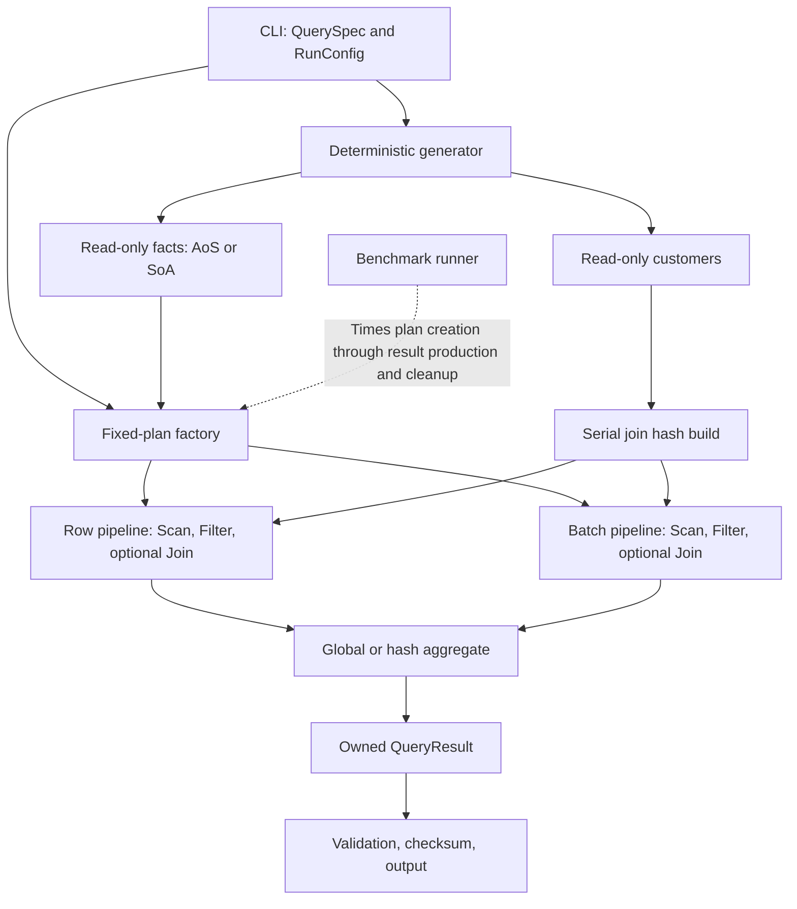

# VQuery — A C++ Vectorized Query Execution Engine

VQuery is a single-machine, in-memory query engine for comparing **row-at-a-time execution with batch-at-a-time execution**. It implements filtering, aggregation, and hash joins, then measures how data layout, operator dispatch, hash tables, and parallel execution affect performance.

**Status: executable MVP with parallel batch execution.** All three engines implement Q1–Q3, including a shared hash table, a managed memory budget, independent correctness tests, and a validated benchmark runner. Debug and Release builds are tested locally on macOS/ARM64; the CI workflow covers Linux Clang/GCC, ASan/UBSan, TSan, and macOS. See the workflow results for the current commit. The Linux performance study, profiling, plots, and v1.0 release report remain open; no speedup claim is made.

Start with [build and run commands](#93-build-and-run), then read the contracts below. Frozen implementation choices are recorded in [docs/decisions.md](docs/decisions.md); the remaining measurement work is tracked in [docs/performance.md](docs/performance.md).

## 1. Goals and Deliverables

The project should answer four questions:

1. Where does execution cost change when operators process one row per call versus a batch per call?
2. How do row and column layouts affect data access and cache behavior?
3. How do filter selectivity, group cardinality, and join build size change the bottleneck?
4. When does adding threads improve throughput, and when do startup, memory traffic, or merging dominate?

The deliverables are a C++ execution engine, independent correctness checks, a reproducible benchmark runner, raw measurements, and a performance report. Completion does not require a predetermined speedup. Explain the observed results using implementation details and profiling evidence, including regressions or negligible improvements when they occur.

For a database-engine portfolio, the emphasis is execution design, data structures, correctness, controlled experiments, and bottleneck analysis. An existing Rust KV project can demonstrate the storage side alongside this execution project. Integrating the two is a later extension.

## 2. Scope and Release Boundaries

| Area | Decision |
| --- | --- |
| Runtime | Single machine, in-memory, read-only |
| Language | C++20 |
| Input | Reproducible synthetic data and small test fixtures |
| Storage layouts | Array of Structures (AoS) and Structure of Arrays (SoA) |
| Operations | Scan, integer comparison filter, required-column selection, COUNT, SUM, single-key GROUP BY, inner hash join |
| Join semantics | Equality join with unique right-side keys; repeated left-side keys are allowed |
| Plans | Three named query templates assembled in code |
| Execution modes | Two row-at-a-time modes and one column-oriented batch mode |
| Parallelism | Batch scanning, filtering, aggregation, and join probing; join build remains serial |
| Output | Materialized aggregate results; CLI output outside the execution timer |

**MVP:** All three engines execute all three queries correctly on one thread, using the shared hash-table implementation and a basic benchmark runner.

**v1.0:** Add parallel batch execution, the defined experiment matrix, profiling, and a reproducible performance report. Project completion means satisfying the v1.0 checklist.

### Out of Scope for v1.0

- SQL parsing, arbitrary SQL, cost-based optimization, and automatic join reordering.
- Persistent storage, CSV/Parquet ingestion, buffer pools, WAL, transactions, and updates.
- Distributed execution, network services, GPUs, and NUMA-specific optimization.
- Strings, NULLs, floating-point data, dates, variable-length values, and composite keys.
- Sort operators, window functions, outer joins, many-to-many joins, and disk spilling.
- JIT compilation, handwritten AVX/NEON intrinsics, and a general expression engine.
- A web UI, Rust KV integration, and a full TPC-H implementation.

Add features after completing this scope. When a change alters the comparison conditions, publish its measurements as a separate experiment.

## 3. Execution Modes and Comparison Rules

| CLI name | Storage | Operator interface | Purpose |
| --- | --- | --- | --- |
| `row-aos` | Array of row structs | One row through `next(Row&)` | Row-oriented baseline |
| `row-soa` | Contiguous arrays by column | One row through `next(Row&)` | Control for storage layout |
| `batch-soa` | Contiguous arrays by column | Up to B rows through `next(Batch&)` | Vectorized execution |

- `row-aos` and `row-soa` share their row operators except for Scan.
- `row-soa` and `batch-soa` use identical logical SoA input and the same hash-table implementation.
- Every engine uses the same query semantics, input values, hash function, build options, and memory budget.
- The main comparison uses one thread. Parallel scaling is measured separately against single-threaded `batch-soa`.
- Compile the row engines normally. Do not weaken a baseline with artificial `volatile` accesses, unnecessary copies, or forced `noinline` annotations.

| Comparison | Main effect under investigation |
| --- | --- |
| `row-aos` vs. `row-soa` | Storage layout under the same row execution model |
| `row-soa` vs. `batch-soa` | Dispatch frequency, loop structure, and intermediate-value handling on column storage |
| `row-aos` vs. `batch-soa` | Combined effect of the two execution designs |
| `batch-soa`, 1 vs. T threads | Parallel scaling within one engine |

This is not a complete 2×2 factorial experiment: there is no `batch-aos` mode, so it cannot independently estimate every interaction between layout and batching. Row Scan materializes the fields requested by the query into a tuple; batch Scan exposes column views, allowing consumers to load some values only after filtering. The comparison therefore includes materialization timing and copying as well as dispatch and loop effects. Do not attribute the entire difference to SIMD or call overhead alone.

Here, **vectorized execution means processing multiple values per operator call**. CPU SIMD is a separate property to verify using compiler diagnostics and assembly. The [X100 paper](https://www.cidrdb.org/cidr2005/papers/P19.pdf) provides research background; [DuckDB's execution-format documentation](https://duckdb.org/docs/current/internals/vector) provides examples of vectors and data chunks.

## 4. Data Model and Semantics

### 4.1 Fixed Schemas

`facts`:

| Column | C++ type | Generated domain / purpose |
| --- | --- | --- |
| `customer_id` | `uint32_t` | Join key; may intentionally have no matching customer |
| `group_id` | `uint32_t` | `0 .. groups-1`; aggregation key |
| `amount` | `int64_t` | `0 .. 1,000,000`; value to sum |
| `score` | `uint32_t` | `0 .. 9,999`; filter input |

`customers`:

| Column | C++ type | Generated domain / purpose |
| --- | --- | --- |
| `customer_id` | `uint32_t` | `0 .. dim_rows-1` in generated data; unique |
| `region_id` | `uint32_t` | `0 .. 15`; aggregation key after the join |

Supported sizes are 0–100,000,000 fact rows and 0–10,000,000 dimension rows, subject to the memory budget. The generator accepts `groups` from 1 to 1,000,000; this is the available key domain, not a guarantee that every group appears. Fixtures may use arbitrary `uint32_t` customer and group keys, including `0` and `UINT32_MAX`, while retaining the row-count, amount, score, and region bounds.

Declare AoS fields in the table order above. Keep normal ABI padding and record `sizeof(FactRow)` and `sizeof(CustomerRow)` in metadata. SoA stores one contiguous vector per column. Major buffers use `std::vector<T, BudgetAllocator<T>>` so allocation requests can be checked before allocating; the allocator only accounts for memory and delegates allocation to the standard allocator. Alignment-specific allocators and memory pools are outside v1.0.

### 4.2 Operator Contracts

- Filtering evaluates `score < cutoff`, with `cutoff` in `0 .. 10,000`. Zero rejects every row; 10,000 accepts every row.
- `COUNT(*)` returns `uint64_t`; `SUM(amount)` returns `int64_t`.
- The supported input bounds limit any sum to `10^14`. Validate fixture bounds before execution; do not rely on signed integer overflow.
- Before creating table views, validate that every SoA column has the declared row count. Validate physical schema and value bounds once outside query timing; keep duplicate join-key detection inside the build phase.
- A global aggregate over empty input returns one row: `(count=0, sum=0)`.
- A grouped aggregate over empty input returns zero rows. Only groups present after filtering/joining are emitted.
- The join matches `facts.customer_id = customers.customer_id`. Unmatched facts are discarded.
- Duplicate right-side keys are an input error, detected during hash build. Do not overwrite them or silently choose one match.
- Result order is unspecified. Sorting for validation or display is outside the execution timer and is not a query sort operator.
- Invalid arguments, unsupported configurations, and allocation failures return an error code and explanation. Partial results are never reported as successful results.

## 5. The Three Queries

The SQL below specifies semantics. Users select a query name and options; the engine does not parse SQL. `COALESCE` describes Q1's empty-input result and does not require a general expression operator.

### Q1 — `filter-sum`

```sql
SELECT COUNT(*) AS n, COALESCE(SUM(amount), 0) AS total
FROM facts
WHERE score < :cutoff;
```

Plan: `Scan(score, amount) → Filter → GlobalAggregate`.

Study operator-call overhead, memory access, and the cost of processing selected rows at different filter selectivities. Do not materialize the full filtered table.

### Q2 — `group-sum`

```sql
SELECT group_id, COUNT(*) AS n, SUM(amount) AS total
FROM facts
WHERE score < :cutoff
GROUP BY group_id;
```

Plan: `Scan(score, group_id, amount) → Filter → HashAggregate`.

Study how group cardinality and skew affect table size, probing, and memory access. Keep hash aggregation in every engine even when keys are small integers; direct-array aggregation would be a separate algorithm comparison.

### Q3 — `join-group-sum`

```sql
SELECT c.region_id, COUNT(*) AS n, SUM(f.amount) AS total
FROM facts AS f
JOIN customers AS c ON f.customer_id = c.customer_id
WHERE f.score < :cutoff
GROUP BY c.region_id;
```

Plan: `Build(customers)`, then `Scan(facts) → Filter → HashJoinProbe → HashAggregate`.

Always build the right-side `customers` table, including when facts are empty or the filter rejects all rows. This preserves duplicate-key validation and a consistent build-cost contract. All engines use the same serial build kernel with an AoS or SoA input accessor; batch and parallel execution apply to the fact-side pipeline.

Emit only `(region_id, amount)` from the join. Stream those values into aggregation without materializing the full join result. Vary build size and match rate to investigate join costs.

The primary metric measures a complete query. Separate diagnostic runs may collect operator timings and hash statistics; do not mix instrumented timings into the primary results.

## 6. Architecture and API Contracts



### 6.1 Responsibilities and Dependencies

| Module | Responsibility |
| --- | --- |
| `common` | Types, errors, results, shared memory-budget state, and counting allocator |
| `storage` | Table ownership, AoS/SoA views, and input-bound validation |
| `hash` | Key lookup and storage, independent of the execution model |
| `runtime` | Execution context and worker coordination |
| `execution` | Scan, Filter, Join, and aggregate sinks; no CLI or benchmark dependencies |
| `workload` | Generator and fixed-plan assembly; no optimizer |
| `bench` | Repetition, measurement boundaries, and raw-result serialization |
| `app` | Argument validation and user-facing output |

Dependencies flow from `app/bench` to `workload/execution/runtime`, then to `storage/hash/common`. Storage and hash containers depend on the budget primitives in `common`, not on the execution runtime. Select an engine once in the plan factory; avoid per-row engine selection in shared code.

### 6.2 Operator and Buffer Lifetimes

Both execution models use pull operators. Aggregation is a sink that consumes its input to completion. Share hash-table and aggregate-state code; keep row and batch processing loops separate.

```cpp
// Public execution interfaces (see include/vquery/execution/operators.hpp).
struct RowSource {
    virtual ~RowSource() = default;
    virtual void open(ExecutionContext&) = 0;
    virtual bool next(Row& out) = 0;
    virtual void close() noexcept = 0;
};

struct BatchSource {
    virtual ~BatchSource() = default;
    virtual void open(ExecutionContext&) = 0;
    virtual bool next(Batch& out) = 0;
    virtual void close() noexcept = 0;
};

QueryResult execute(QuerySpec, const Tables&, ExecutionContext&);
```

- `false` from `next` means end of input. A successful batch call must return at least one logical row. Filter and Join skip empty intermediate batches internally.
- `Row` contains the fixed-type fields needed by the query. Avoid `std::any` and per-value runtime expression interpretation.
- Tables remain alive and immutable throughout execution. Scan exposes column data through `std::span<const T>`.
- A returned batch view and its selection indices remain valid **until the next `next` or `close` call on that source**. Its parent must consume it before advancing the source.
- Filter owns its selection buffer. Join owns and reuses its `(region_id, amount)` output columns.
- `QueryResult` owns its output. RAII releases intermediate resources on success and failure. `close` is idempotent and safe after a partially completed `open`; destruction must not depend on the caller remembering to close.
- `execute` creates fresh query state and releases intermediate state before returning. The caller retains the input tables and the returned result.

Inside the library, failures propagate as typed exceptions carrying an engine error category; allocation and thread-system errors are translated at the execution boundary. The CLI and benchmark entry points catch them, emit the documented error/status, and exit nonzero. The `QueryResult` return type represents success only. This keeps error propagation consistent with the worker-exception contract without introducing a second error-return API.

### 6.3 Batches and Selection Vectors

Start with `B=2048` and evaluate `256, 512, 1024, 2048, 4096, 8192`. The default is a starting point, not a claim of optimality. DuckDB also documents a default vector size of 2048. [DuckDB Execution Format](https://duckdb.org/docs/current/internals/vector).

A Batch contains fixed-type column views, a `physical_count`, a `logical_count`, and an optional array of `uint32_t` selection indices. The plan factory determines the schema.

- A dense batch has no selection array and equal physical and logical counts.
- A filtered batch has `logical_count` indices, each identifying a physical position in that batch.
- Batch-relative indices use `uint32_t`; table offsets use `size_t`. Do not confuse the two coordinate systems.
- A downstream filter follows the existing selection and emits physical positions. It must not accidentally treat those positions as indices into the selection array.
- Join probes selected fact rows and compacts matches into a dense output batch.
- Unique build keys mean join output cannot exceed probe input. A B-row output buffer is sufficient.
- Allocate Filter and Join buffers during `open` and reuse them. Hash aggregation may grow its table during execution.

### 6.4 Shared Hash Table

Implement an open-addressed hash table for the primary execution path.

| Property | Decision |
| --- | --- |
| Key | One `uint32_t` |
| Hashing | A fixed-seed 64-bit integer mixer, defined with unsigned arithmetic and frozen test vectors |
| Collisions | Linear probing |
| Capacity | Power of two; maximum load factor 0.70 |
| Empty slots | Separate occupancy array; no reserved key value |
| Deletion | Unsupported |
| Aggregate payload | `{uint64_t count, int64_t sum}` |
| Join payload | `uint32_t region_id` |
| Initial group-table size | 1024 slots; double and rehash when necessary |
| Initial join-table size | Reserve from dimension row count, rounded up for the load limit; minimum one slot for an empty input |

Use the same hash algorithm and fixed hash seed in every engine; the data-generation seed does not change them. Freeze the mixer constants and vectors in M0. Grow an aggregation table only when a new key would exceed the load limit; updating an existing key should not trigger growth.

Do not pre-count actual groups to reserve an exact aggregation capacity. Resizing and rehashing are part of query time. Join may reserve using the known input row count. Apply these rules consistently across engines.

Provide `insert_unique`, `find`, and `find_or_insert`. Detect duplicate join keys during build, including its cost in the query timer. Collect probe counts, maximum probe length, and resize counts only in diagnostic runs. Standard associative containers are allowed in the independent reference implementation, not the primary execution path.

### 6.5 Parallel Execution

Only `batch-soa` supports parallel execution in v1.0. Partition facts into T contiguous row ranges. Each worker owns its Scan, Filter, batch buffers, and local aggregate state.

- Q1: reduce worker-local counts and sums on the calling thread.
- Q2: merge worker-local hash aggregates by key on the calling thread.
- Q3: build one join table on the calling thread, then publish it as immutable state to workers. Probe and aggregate locally; merge after workers finish.
- Do not mutate the published join table or lock a shared aggregate table per row.
- Use `std::jthread` per query. Include thread startup, joins, and final merging in the execution time; do not implement a general scheduler or work stealing.
- With `threads=1`, execute on the calling thread. With `threads=T>1`, launch T data-processing workers; the calling thread coordinates and waits.
- v1.0 accepts T in `{1, 2, 4}`. Do not silently clamp the requested count. Empty worker ranges are valid, including when `N<T`.
- Correctness tests may oversubscribe small machines. Published scaling experiments use only counts within the available physical-core budget and record the actual affinity policy.
- Before launching threads, allocate one result slot and one `std::exception_ptr` slot per worker, plus one shared `std::stop_source`. Worker i writes only slot i; the caller reads those slots only after joining. Worker code must not inspect or modify the vector of thread handles while the caller is still creating threads.
- Workers capture the shared stop token explicitly and poll it at batch boundaries; do not accidentally substitute a `jthread`'s separate automatic token. A failing worker stores its exception and requests stop through the shared source. If thread creation fails, the caller requests the same stop, joins every already-created worker, and reports the creation failure. Otherwise, after all joins, report the lowest-index worker error if any; discard partial results on failure.
- On success, explicitly join all workers before merging. Do not rely on destruction of joinable `std::jthread` objects as the normal completion path: their destructors request stop before joining. No exception may escape a worker entry point. [C++ draft: jthread destruction](https://eel.is/c++draft/thread.jthread.cons), [stop-source semantics](https://eel.is/c++draft/stopsource.mem).

## 7. Memory Budget and Failure Handling

The default managed-memory budget is 4096 MiB, configurable through `--memory-limit-mib`. It limits tracked engine buffers, not operating-system RSS.

Track input arrays, selection and join-output buffers, hash slots, result arrays, and worker-local states. A thin `BudgetAllocator<T>` checks overflow in `n * sizeof(T)`, atomically reserves that many bytes before delegating an allocation, rolls back on allocation failure, and releases the reservation on deallocation. This accounts for actual allocation requests rather than checking vector capacity after memory has already been allocated.

During growth, old and new buffers are both charged until the old allocation is released. Input and query allocations carry separate accounting categories under one shared limit. Record query-buffer peak bytes per execution, including its final result. Allocators retain shared ownership of budget state so a returned result can safely outlive its execution context. Accounting occurs at allocation/deallocation boundaries, not per row.

Define allocator identity as the pair `(budget state, accounting category)`. Copies and rebinds retain both. Set `is_always_equal=false`, `propagate_on_container_copy_assignment=false`, `propagate_on_container_move_assignment=true`, and `propagate_on_container_swap=true`; allocator move and swap operations must not throw. Container copy assignment retains the destination allocator. Move or swap the allocator with its owned allocation so later deallocation charges the original budget correctly; never relabel an existing allocation without transferring its accounting. Return results by moving their owned containers without supplying a different allocator. These rules follow the requirements for [allocator-aware containers](https://eel.is/c++draft/container.alloc.reqmts) and [allocator propagation](https://eel.is/c++draft/container.reqmts).

Start each timed invocation with no live allocation in its query category, after destroying the preceding result. Reset the query peak only at that point; leave the input category and shared total intact. Test moving results across contexts and budgets as well as their destruction after the original execution context has gone away.

Small control objects, allocator bookkeeping, thread stacks, and standard-library internal allocations are outside the managed-buffer budget. Report process RSS separately; do not describe the budget as a complete process-memory cap.

Each large benchmark process holds only the storage layout required by its selected engine. Do not generate both AoS and SoA and retain one after conversion, since that can contaminate peak RSS. Small correctness tests may hold both layouts.

Reject an allocation before exceeding the tracked limit. Catch allocation failures and return a structured failure without partial results. Benchmark failures use statuses such as `memory_limit`, `allocation_failed`, or `correctness_failed`; failed runs are excluded from successful performance summaries and remain in the raw record.

## 8. Repository Layout

```text
vquery/
├── README.md
├── CMakeLists.txt / CMakePresets.json
├── cmake/Dependencies.cmake     # GoogleTest version + archive SHA-256
├── include/vquery/
│   ├── common/                 # Types, errors, checksum, budget allocator
│   ├── storage/tables.hpp      # AoS/SoA tables, fixtures, generator API
│   ├── execution/operators.hpp # Row/batch sources and execute API
│   ├── hash/hash_table.hpp     # Shared open-addressed hash table
│   └── runtime/context.hpp     # Query spec, execution context, failure hooks
├── src/
│   ├── common/memory.cpp
│   ├── storage/tables.cpp
│   ├── execution/
│   │   ├── operators.cpp       # Row/batch Scan, Filter, and Join
│   │   └── execute.cpp         # Aggregate, build, worker coordination, merge
│   └── workload/generator.cpp
├── app/                        # CLI parsing, serialization, vquery entry point
├── bench/
│   ├── main.cpp                # Timers, repetition, JSONL, atomic metadata
│   └── manifests/              # smoke, core, sensitivity, parallel
├── tests/
│   ├── core_test.cpp           # Allocator, hash, generator, storage
│   ├── execution_test.cpp      # Independent oracle and execution failures
│   ├── cli_test.py             # Executables and full runner integration
│   └── runner_test.py          # Corruption and whole-run exclusion
├── scripts/
│   ├── run_bench.py            # Full-output validation and run orchestration
│   └── summarize.py            # Complete valid runs → JSON/CSV summaries
├── docs/
│   ├── decisions.md
│   └── performance.md          # Pending study plan; no measured claims yet
└── .github/workflows/ci.yml
```

The CLI, benchmark runner, and tests link the same `vquery_core` library. Exclude generated input data, build directories, temporary results, and large `perf.data` files from Git. Commit selected reproducibility artifacts and plots. Create modules as they become necessary rather than filling every directory with empty abstractions first.

## 9. Toolchain and Usage

### 9.1 Tools and Platforms

- C++20, CMake 3.25 or newer, and Ninja.
- Clang 17 or newer for primary development; GCC 13 or newer for secondary validation. Record exact compiler and standard-library versions for measurements.
- No external runtime dependency in the core engine.
- Pin GoogleTest 1.17.0 and record the downloaded archive's SHA-256 in M0. Do not track a moving branch. [GoogleTest release](https://github.com/google/googletest/releases/tag/v1.17.0).
- Use a dedicated `std::chrono::steady_clock` benchmark runner. Use Python 3.11 or newer and its standard library for orchestration and summaries; pin any plotting dependency when implementing the report.
- Use Linux x86-64 for the main performance report, preferably with at least four physical cores and 16 GiB RAM. Support macOS/ARM64 with a standard library providing `std::jthread` for development and correctness checks (CI uses macOS 26); keep its performance results separate. Validate the chosen standard library's C++20 facilities, including `std::jthread`, in M0.

### 9.2 Build Policy

Provide matching configure, build, and test presets named `debug`, `release`, `asan-ubsan`, and `tsan`. ASan/UBSan and TSan use separate builds.

Use `-O3 -DNDEBUG` consistently for Release. Leave LTO and host-specific ISA tuning off by default. All primary comparisons use one common binary. Experiments enabling native ISA options or LTO receive distinct configuration identifiers. Timings from sanitizer or diagnostic/profiling builds do not enter the primary performance table.

Use compiler vectorization reports to investigate SIMD. For Clang, relevant flags include `-Rpass=loop-vectorize` and `-Rpass-missed=loop-vectorize`. An optional comparison with automatic vectorization disabled must apply `-fno-vectorize -fno-slp-vectorize` to every engine in that build. [LLVM Auto-Vectorization](https://llvm.org/docs/Vectorizers.html).

### 9.3 Build and Run

Run these commands from the repository root. The first test-enabled configure downloads the pinned GoogleTest archive; C++ builds require no package-manager installation of GoogleTest. Python is needed for integration tests and benchmark orchestration. Use a new output directory for each run; existing results are never overwritten by the runner.

```bash
cmake --preset debug
cmake --build --preset debug
ctest --preset debug

cmake --preset release
cmake --build --preset release
ctest --preset release

# Fast end-to-end check: 15 configurations, no warmup/calibration, four samples.
python3 scripts/run_bench.py --manifest bench/manifests/smoke.json \
  --output-dir results/local/smoke --exploratory

# Inspect results on a small input.
./build/release/vquery --query filter-sum --engine batch-soa \
  --rows 100000 --cutoff 5000 --batch-size 2048 --threads 1 --seed 42

# Explore one configuration; publication validation is performed by run_bench.py.
./build/release/vquery_bench --query join-group-sum --engine batch-soa \
  --rows 1000000 --dim-rows 100000 --match-rate 1.0 --cutoff 5000 \
  --batch-size 2048 --threads 1 --seed 42 --warmup 3 --repetitions 15 \
  --memory-limit-mib 4096 --output results/local/join.jsonl

# Validate and run the core comparison matrix, then summarize it.
python3 scripts/run_bench.py --manifest bench/manifests/core.json \
  --output-dir results/local/core
python3 scripts/summarize.py --input-dir results/local/core
```

`core.json` contains 27 comparison configurations. `sensitivity.json` contains one-variable sweeps with duplicate defaults removed by the runner. `parallel.json` covers 1/2/4 threads and requires enough detected physical cores for a publication run. Publication runs require a clean checkout, reconfigure/build/test the Release preset, and bind validation to both executable SHA-256 digests. `--exploratory` allows an existing custom build or dirty checkout and labels every resulting summary accordingly. A Debug smoke run adds `--build-dir build/debug`.

For sanitizer builds, use the corresponding `asan-ubsan` or `tsan` configure/build/test preset. Run them separately. Some macOS sandbox environments cannot start sanitizer runtimes; Linux CI is the sanitizer validation environment for this project.

Reject explicitly supplied options that do not apply. Row engines reject `threads>1` and any explicit `--batch-size`. Q1 rejects `--groups`, join options, and an explicit `--distribution`; Q2 rejects join options; Q3 rejects `--groups`. The orchestration script passes only applicable flags.

| Option | Default | Applies to |
| --- | --- | --- |
| `--rows` | 1,000,000 | All queries |
| `--cutoff` | 5000 | All queries |
| `--groups` | 1024 | Q2 |
| `--dim-rows` | 100,000 | Q3 |
| `--match-rate` | 1.0 | Q3 |
| `--distribution` | `uniform` | Q2 and Q3 |
| `--seed` | 42 | All queries |
| `--batch-size` | 2048 | `batch-soa` |
| `--threads` | 1 | All engines; only `batch-soa` accepts 2 or 4 |
| `--memory-limit-mib` | 4096 | All engines |
| `--warmup` | 3 | Benchmark executable |
| `--repetitions` | 15 samples | Benchmark executable |
| `--format` | `text` | `vquery` only; accepts `text` or `json` |
| `--expected-input-checksum`, `--expected-result-checksum`, `--validation-id` | Unset | Benchmark executable; supplied together by the validation runner |

Accept batch sizes from the six specified values. Accept `uniform` and `hot-key-90` distributions. Parse match rates in `[0,1]` with up to four decimal places into integer basis points to make sampling independent of floating-point parsing differences. Require a positive memory budget and repetition count, a nonnegative warmup count, and an unsigned 64-bit seed.

All four fact columns exist in every layout, even when a query reads only some of them. Generator settings for unused fields are fixed internal defaults and recorded as part of the generator version. Only Q3 constructs the dimension table. Benchmark result records use `null` for inapplicable public options. Create requested output parent directories and report output failures explicitly; never silently replace an existing run file.

`vquery --format json` writes one complete JSON object to stdout: `schema_version`, normalized query/generator/engine configuration including generator and checksum-serialization versions, `input_checksum`, `result_checksum`, and `rows`. Each result row has `key`, `count`, and `sum`; Q1 uses `key=null`, Q2 uses the group key, and Q3 uses the region key. Sort grouped rows by key before serialization. Send diagnostics to stderr so the runner can capture machine-readable results without scraping human output. The expected-checksum flags accept 16 hexadecimal digits and the validation ID accepts 64 hexadecimal digits; supplying only part of the three-flag validation tuple is an argument error.

## 10. Benchmark Methodology

### 10.1 Reproducible Input

The same generator version, seed, schema, and parameters must produce the same logical values. Use `std::mt19937_64` output and an explicitly defined rejection sampler; do not rely on standard-library distribution implementations for identical sequences across platforms.

Use independent streams with fixed IDs and seed derivation for columns, match decisions, matched-key selection, and skew decisions. Advance each applicable stream consistently per row so conditional generation cannot shift later values unexpectedly. Changing group count or join distribution must not change scores or amounts. For a match probability of p basis points, draw a uniform integer in `0 .. 9,999` and match when it is below p. Freeze stream IDs, seed derivation, and sampling rules in M0 and cover them with golden tests.

Generate directly into the selected layout using a fixed logical traversal order. Compute input checksums from canonical fixed-width little-endian logical values, excluding structure padding. Use FNV-1a 64-bit, with table identifiers and row counts included in the serialization. Compute result checksums from canonically sorted key/count/sum tuples; the ungrouped Q1 result has a fixed one-row encoding. Checksums identify runs and detect mismatches; full result comparisons establish correctness.

The default distribution is uniform. `hot-key-90` selects key 0 with probability 90% and otherwise selects among the other valid keys. Apply it to group keys in Q2 and to matched customer keys in Q3. If only one valid key exists, use it for every applicable row. This is a probabilistic distribution, not an exact 90% row count.

Cutoff defines the target filter selectivity. Record observed selected rows and observed join matches, since sampling can change the realized rates. With `dim_rows=0`, require `match_rate=0`. Generate nonmatching keys outside the dimension key range. Define observed match rate as matched rows divided by selected fact rows, or `null` when no fact survives the filter.

### 10.2 Experiment Matrix

Default conditions: `N=1,000,000`, `cutoff=5000`, `groups=1024`, `M=100,000`, `match_rate=1.0`, uniform distribution, `B=2048`, `T=1`, and seed 42. Apply only the fields relevant to each query and engine.

| Experiment | Variable | Fixed conditions / engines |
| --- | --- | --- |
| Core comparison | Three engines × three queries × N={100K, 1M, 10M} | Defaults otherwise; 27 configurations |
| Filter selectivity | cutoff={0, 100, 1000, 5000, 10000} | Q1; all engines |
| Group cardinality | groups={1, 1024, 100000} | Q2; all engines |
| Group skew | uniform / hot-key-90 | Q2; groups=1024; all engines |
| Join build size | M={1K, 100K, 1M} | Q3; all engines |
| Join match rate | match_rate={0, 0.5, 1.0} | Q3; all engines |
| Join skew | uniform / hot-key-90 | Q3; all engines |
| Batch size | B={256, 512, 1024, 2048, 4096, 8192} | Q1/Q2/Q3; batch-soa; T=1 |
| Thread count | T={1, 2, 4}, within the physical-core budget | Q1/Q2/Q3; batch-soa; N=10M |

Run one variable sweep at a time, remove duplicate default configurations, and avoid the Cartesian product of every option. Confirm representative findings with seeds 7 and 2026. Distinguish variability across generated datasets from repeated timing variability on one dataset.

### 10.3 Correctness Before Timing

Before publishing a configuration, run an untimed validation pass in separate processes for each applicable execution mode using `vquery --format json`. First require identical input checksums and normalized query/generator settings, then compare the complete, canonically sorted outputs, including different thread counts and batch sizes where applicable. A batch-only sweep must also validate its outputs against `row-soa` on the same input, even if that control's time is not plotted. The runner may use temporary result files for comparison.

Small inputs additionally use the independent reference implementation in Section 11. Full-size cross-engine agreement complements those tests; it is not a replacement for an independent oracle.

After successful comparison, write a validation manifest containing the query and generator settings, input and result checksums, generator/serialization versions, the tested engine/thread/batch configurations, memory limit, and SHA-256 identities of both executable files. Compute `validation_id` from the canonical manifest content. A CLI validation binary and a timing binary must come from the same build of `vquery_core`; track both identities because they are separate executables. Revalidate after changing either executable or any setting relevant to correctness. Temporary full-output files may then be removed; retain the manifest.

The Python runner checks that manifest against the current executables and resolved settings, then passes `--expected-input-checksum`, `--expected-result-checksum`, and `--validation-id` to the benchmark. Before starting warmups, the benchmark checks its generated input checksum. Consume and check every warmup and timed result after stopping the relevant timer. Any mismatch invalidates the entire run and is recorded as `correctness_failed`. Without the tuple, record `validation_status=unchecked`; with matching expectations, record `validation_status=checksums_matched`. Publication additionally requires the runner's matching validation manifest; a supplied ID or matching checksum alone does not establish full-output validation.

Keep reference computation and full-output comparison out of timed processes to avoid contaminating their allocator state and peak RSS. Compute auxiliary counts such as `selected_rows` in the validation pass; do not add per-row diagnostic counters to the primary hot loops.

### 10.4 Timing Boundary

Measure **prepared input tables and a validated QuerySpec → an owned QueryResult, with intermediate state released**.

| Included in query time | Excluded from query time |
| --- | --- |
| Plan construction and query-state creation | Input generation and full value-bound validation |
| Operator open and query-buffer allocation | Input layout generation/conversion |
| Join build, including duplicate-key checks | Reference result computation |
| Scan, Filter, Probe, and aggregation | Result sorting and correctness comparisons |
| Hash growth and result materialization | Checksum calculation and serialization |
| Worker startup, joins, and merging | JSON, console, and file output |
| Intermediate-state and operator cleanup | Destruction of the returned result and input tables |

The timed API also performs constant-time configuration, budget-identity, and column-length checks. Full fixture value validation occurs during preparation.

Release intermediate execution state before returning from `execute`. Retain only the final result in the caller. Each invocation gets fresh query state; do not retain hash tables or operator buffers across repetitions. Input tables stay resident across repetitions in a process. The system allocator may reuse freed memory, so this is a steady-state allocation workload, not a cold-allocation experiment.

Read every result after timing, compute its checksum, and compare it when a validated expectation exists. Destroy the result before the next invocation. Serialize sample records outside the timer. Keep results observable so the compiler cannot discard unused computation.

### 10.5 Repetition, Statistics, and Environment

- Run three complete warmup queries, then collect 15 measured samples by default.
- If the median warmup query time is positive and below 10 ms, choose K so its expected cumulative query time is at least 100 ms. Otherwise use K=1. A zero median is below measurement resolution and must be reported as an invalid timing configuration. Freeze K for the measured samples. To bound work on tiny inputs, reject K > 10,000 with guidance to increase N or use zero-warmup exploratory timing; do not silently reduce K.
- A sample contains K separately timed `execute` calls. Sum their durations and divide by K. Result consumption, checking, and destruction happen after each call's timer stops. Record both K and the actual cumulative measured duration.
- With zero warmups, use K=1 rather than running an undocumented calibration phase. Reject a zero-duration sample as below measurement resolution instead of dividing by zero.
- Run each configuration in a fresh process. Randomize configuration order with a recorded scheduling seed and interleave engines where possible.
- Report median and interquartile range (IQR), preserving every requested sample record (15 by default). Grouped samples describe average query cost per sample; they are not a tail-latency distribution. Do not claim p99 from this protocol. For fewer than four samples, report IQR as unavailable and label the run exploratory.
- Describe the workload as repeated execution over memory-resident input after warmup. Do not assume the whole dataset fits in CPU cache or label it a cold-cache experiment.
- Compare on the same machine, binary, input, and power configuration. When available, pin to a core set appropriate to T and record the mapping.
- Record CPU model, physical/logical core counts, available cache-capacity information, RAM, OS/kernel, compiler/standard library, flags, Git revision and dirty state, generator version, clock details, and timestamp. For published runs require a clean source revision, pinned dependency hashes, and the executable identities from validation.
- Flag `IQR / median > 10%` as high variability. Investigate without selectively dropping samples; retain a rerun under a new run identifier.
- CI benchmarks check execution and output shape. Shared CI machines do not enforce speedup targets.

### 10.6 Result Records and Interpretation

Write one JSONL record per sample. Required fields are:

```text
schema_version, run_id, trial, validation_id, engine, query, rows, dim_rows, groups, cutoff,
match_rate_bps, distribution, seed, generator_version, input_checksum,
batch_size, threads, repetitions_in_sample, elapsed_ns_total,
elapsed_ns_per_query, selected_rows, joined_rows, result_rows,
result_checksum, validation_status, managed_input_bytes,
managed_query_peak_bytes, process_peak_rss_bytes, status, metadata_path
```

Use `null` for inapplicable or unavailable fields. Represent checksums as fixed-width hexadecimal strings. `match_rate_bps` is the integer form of `--match-rate`; for example, 1.0 becomes 10000. For K>1, report the maximum query-buffer peak among the K invocations. RSS is a cumulative process high-water mark observed at that sample, not a resettable per-query peak.

`metadata_path` is a filename relative to its raw JSONL file, so a result directory can be moved intact. Missing hardware/RSS information is recorded as `null`. The JSON metadata referenced by `metadata_path` includes the fully resolved command/configuration, requested warmups and sample count, memory limit, calibration rule and chosen K, scheduling seed, validation-manifest reference, executable identities, environment, and run completion state. Keep workload identity separate from engine settings when matching comparison pairs. Do not pool measurements from different binaries, machines, or timing protocols.

A run is publishable only after all requested samples succeed, all expected checksums match, the output files close successfully, and metadata is finalized with `completion_state=complete` and `run_status=ok`. Finalize that metadata atomically after writing the raw samples. Any later failure invalidates earlier samples from the same run for publication; preserve them for diagnosis. A crash, truncated record, missing trial, duplicate trial, or unfinished metadata makes the run incomplete. `summarize.py` must exclude the entire failed/incomplete run rather than averaging its surviving successful samples. Unchecked standalone runs may receive a clearly labeled exploratory summary, but never enter the published comparison.

- **Throughput:** fact input rows divided by query time. For Q3, the timer includes build cost but the numerator remains N; display M alongside it.
- **Speedup:** baseline median divided by comparison median for the same logical input, query, platform, and build.
- **Parallel efficiency:** single-thread time divided by T-thread time, then divided by T.
- **Memory:** report managed input bytes, peak managed query bytes, and process RSS separately. RSS includes input, runtime, and other allocations; it is not incremental query memory.
- **Diagnostics:** collect cycles, instructions, branch misses, cache misses, sampled function costs, and hash probe statistics in separate runs where supported. Unsupported or inaccessible PMU events are `unavailable`.
- **Operator timings:** label inclusive versus exclusive time. Nested pull calls can include child work; summing inclusive timings does not produce total query time.

Whole-process `perf stat` measurements include generation and setup. To report counters scoped to execution, start with events disabled and use control-FIFO enable/disable commands with acknowledgements around the measured work. Ensure counters cover all worker threads, document the synchronization overhead, and keep this instrumentation separate from primary timing. If scoping is unavailable, label the data as whole-process diagnostics and do not derive query cycles per row. [perf stat manual](https://man7.org/linux/man-pages/man1/perf-stat.1.html).

The report must show engine latency, selectivity sensitivity, group/build-size sensitivity, batch-size sensitivity, and thread scaling. Record the actual hash capacity and allocated footprint in diagnostic runs; do not assume that a particular row count exceeds a cache level. Do not treat differently named hardware events as interchangeable across CPUs. Use available counters and profiles to support cache-related explanations; elapsed time alone does not establish a cache mechanism.

## 11. Correctness Testing and CI

### Independent Reference Implementation

Use straightforward loops and standard associative containers for small-input Q1/Q2 references. Use a nested-loop join for the small-input Q3 reference. Reference code must not call the engine's Filter, HashTable, or Aggregate implementations.

Sort grouped outputs by key and compare every key, count, and sum exactly. A checksum alone is insufficient. All engines and supported thread counts must agree with the reference.

### Required Cases

- Zero and one fact row, an empty dimension, all-pass and all-fail filters, and incomplete final batches.
- For each B: `B-1`, `B`, `B+1`, and `2B+1` rows; empty filtered and unmatched join batches in the middle of an input.
- Keys `0` and `UINT32_MAX`, repeated groups, maximum allowed amount, and many distinct keys.
- All-matching and all-nonmatching joins, repeated left keys, and duplicate right keys, including with empty facts or cutoff zero.
- Forced hash collisions using a test hash policy, wraparound probing, growth boundaries, existing-key updates at the load limit, and value preservation after rehash.
- Selection-index bounds and composition, buffer-consumption contracts, operator reuse, and cleanup after partial `open` failure.
- Budget exhaustion before allocation, byte-size overflow, injected allocation failures, returned-result lifetime, worker exceptions, and failure partway through thread creation.
- Allocator copy/rebind/move/swap across unequal budget identities, exact release accounting, and peak reset only after all prior query buffers are freed.
- Simultaneous worker failures, shared cancellation during startup, and successful completion without destructor-triggered cancellation.
- Mismatched SoA column lengths; stale validation manifests; mismatched input checksums; corrupted/truncated output; a failure after earlier successful samples; exclusion of failed/incomplete runs from summaries.
- Seeds 0..99 on small randomized datasets. Limit N to 2000 and M to 128 for the nested-loop reference.
- Parallel results for 1/2/4 threads, uneven range boundaries, and fewer rows than workers.

CI builds and tests Linux Clang/GCC in Debug and Release, plus a separate ASan/UBSan job. Add Linux TSan when parallel execution is introduced. Test a macOS build and small correctness cases on an available runner. Performance ratios are never CI pass/fail criteria.

## 12. Implementation Milestones

Complete milestones in order while preserving the previously validated execution paths. Split each milestone into small commits or PRs. Assign calendar dates once the available development time is known.

| Milestone | Work | Exit criteria |
| --- | --- | --- |
| M0: Foundations | Build presets, pinned tests, types, errors, generator, AoS/SoA storage, budget allocator, frozen hash/generator rules | Clean build; generator golden tests; identical logical input across layouts; allocation accounting verified |
| M1: First complete query | `row-aos` Q1, CLI, independent reference | Generate → execute → print works; empty-input and filter-boundary tests pass |
| M2: Control and batch modes | Q1 in `row-soa` and `batch-soa`, Batch and selection contracts | Exact agreement across modes; tail/empty-batch tests pass; basic timing available |
| M3: Hash aggregation | Shared hash table and Q2 in all engines | Collision, growth, cardinality, and randomized differential tests pass |
| M4: Hash join / MVP | Unique-key build, probe, Q3, validation and benchmark runner | Duplicate-key errors, nonmatches, reference join agreement, and reproducible single-thread measurements |
| M5: Parallel execution | Range partitioning, local state, immutable join sharing, merge | 1/2/4-thread agreement; TSan passes; startup and merge costs included |
| M6: Experiments and profiling | Defined matrix, profiling, SIMD inspection, raw-data preservation | Complete metadata; at least two bottleneck hypotheses assessed with evidence |
| M7: Release documentation | Plots, performance report, verified commands, README status update | Clean-checkout reproduction and all v1.0 acceptance criteria met |

**Current implementation:** M0–M4 are implemented; M5 parallel execution and failure tests are implemented, with sanitizer acceptance determined by the current CI run. M6/M7 remain the next project work. Experiment manifests are available, but their presence does not mean the performance study has been completed.

M4 includes the JSON output contract, validation manifests, and complete-run summary checks. M5 adds concurrent-failure and cancellation tests before any parallel performance measurements.

During M6, state a hypothesis before changing code and change one factor at a time. Examples include selection indirection at low selectivity and probe costs as the join table grows beyond cache capacity. Preserve comparable before/after measurements for changes that help and for changes that do not.

## 13. Risks and Later Extensions

| Risk | Response |
| --- | --- |
| SQL support expands scope | Keep three fixed QuerySpecs and postpone parsing |
| An unfair baseline exaggerates gains | Share semantics, hash structures, and build options; retain `row-soa` and document materialization differences |
| Batching produces little or no speedup | Report the outcome and inspect dispatch, selections, hashing, memory access, and compiler output |
| Hash-table bugs invalidate measurements | Complete independent, forced-collision, growth, and randomized tests before analysis |
| Parallel local state increases memory | Charge all local tables and merge-time overlap to the shared budget |
| Dangling batch views | Enforce ownership and invalidation contracts; test boundaries under ASan |
| Experiment count becomes unmanageable | Use the 27 core configurations and one-variable sweeps |
| Platform-specific measurements are misleading | Separate platforms, retain metadata, and identify missing PMU support |

After v1.0, consider one extension at a time: many-to-many join with resumable output, explicit SIMD filtering, radix-partitioned joins, strings/NULLs, file ingestion, or a Rust KV adapter. None is required for this release.

A Rust KV adapter would convert scan output into column batches. Measure storage access plus conversion separately from execution over already prepared tables, and provide an additional integrated measurement when the adapter exists.

## 14. v1.0 Acceptance Checklist

- [ ] All three engines support all three queries and reject unsupported input explicitly.
- [ ] Independent references, boundary cases, and randomized differential tests pass.
- [ ] ASan/UBSan and parallel TSan checks pass on the documented validation toolchain.
- [ ] Equivalent operations share the hash implementation and comparable build settings.
- [ ] Batch results agree at 1/2/4 threads; scaling measurements use available physical cores.
- [ ] Input generation, query timing, result validation, and diagnostic instrumentation have separate boundaries.
- [ ] Pre-allocation budget enforcement, failure cleanup, and memory metrics follow the stated contracts.
- [ ] Allocator moves/swaps preserve budget ownership; simultaneous worker failures cannot race on error storage or return partial success.
- [ ] Published configurations pass full-output cross-engine validation; timed results match their validated checksums.
- [ ] Validation is bound to the tested inputs, configurations, and binaries; failed or incomplete runs cannot contribute samples to published summaries.
- [ ] Core and sensitivity experiments retain raw samples, parameters, environment metadata, and the exact source revision.
- [ ] At least two bottleneck hypotheses are assessed with profiling evidence; regressions and negligible improvements are reported when observed.
- [ ] The report distinguishes measured findings from untested assumptions and provides reproduction commands.
- [ ] A clean checkout can build, test, run a small benchmark, and produce a summary.

## 15. References

- [MonetDB/X100: Hyper-Pipelining Query Execution](https://www.cidrdb.org/cidr2005/papers/P19.pdf): background on vector-at-a-time query processing.
- [DuckDB Execution Format](https://duckdb.org/docs/current/internals/vector): vectors, data chunks, and selection-based representations.
- [LLVM Auto-Vectorization](https://llvm.org/docs/Vectorizers.html): investigating SIMD separately from batch execution.
- [Linux perf stat](https://man7.org/linux/man-pages/man1/perf-stat.1.html): hardware-event collection and measurement controls.
- [C++ draft: allocator-aware containers](https://eel.is/c++draft/container.alloc.reqmts), [allocator propagation](https://eel.is/c++draft/container.reqmts), [jthread lifetime](https://eel.is/c++draft/thread.jthread.cons), and [stop sources](https://eel.is/c++draft/stopsource.mem): language-library contracts relevant to ownership and cancellation.

These sources inform the design. Evaluate VQuery against its own stated scope and experimental conditions; do not claim to reproduce another engine or its published performance.
