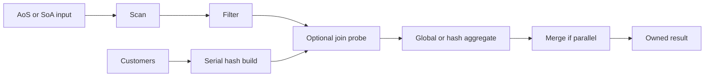

# Query execution

This document describes the input, fixed plans, and ownership rules behind the CLI.

## Data and queries

| Table | Fields |
| --- | --- |
| `facts` | `customer_id: uint32`, `group_id: uint32`, `amount: int64`, `score: uint32` |
| `customers` | `customer_id: uint32`, `region_id: uint32` |

Limits are 100 million fact rows, 10 million dimension rows, amounts in `[0, 1,000,000]`, scores in `[0, 9999]`, and regions in `[0, 15]`. The generator supports 1–1,000,000 group keys. Fixtures can use any `uint32` customer/group key, including `UINT32_MAX`. Counts use `uint64` and sums use `int64`; the largest supported sum is `10^14`.

All four fact columns exist in every layout. Only the join query allocates customers. Generated inputs use independent `mt19937_64` streams and rejection sampling so layout, compiler, or skew changes do not shift unrelated columns. The same seed and logical parameters produce the same values across engines. `hot-key-90` gives key zero a 90% probability in Q2 groups or Q3 matching customer keys. With a single key, every applicable row uses it. Exact stream and checksum rules are in [decisions.md](decisions.md).

The SQL describes semantics; the CLI selects plans by name.

**Q1: `filter-sum`** — Scan → Filter → global aggregate.

```sql
SELECT COUNT(*), COALESCE(SUM(amount), 0)
FROM facts WHERE score < :cutoff;
```

**Q2: `group-sum`** — Scan → Filter → hash aggregate.

```sql
SELECT group_id, COUNT(*), SUM(amount)
FROM facts WHERE score < :cutoff
GROUP BY group_id;
```

**Q3: `join-group-sum`** — serial customer hash build, then Scan → Filter → join probe → hash aggregate.

```sql
SELECT c.region_id, COUNT(*), SUM(f.amount)
FROM facts f JOIN customers c ON f.customer_id = c.customer_id
WHERE f.score < :cutoff
GROUP BY c.region_id;
```

A cutoff of zero rejects all rows; 10000 accepts all. Q1 always returns one row, with zero count/sum for empty input. Q2/Q3 return only surviving groups, so empty input produces no rows. Repeated fact keys are allowed; unmatched facts are discarded. Duplicate customer keys fail during build, even with no facts or cutoff zero. An empty dimension requires a zero generated match rate.

The query result owns its rows. Group order is unspecified inside the engine; the CLI sorts by key outside query timing. JSON result rows contain `key`, `count`, and `sum`, with `key: null` for Q1. Errors go to stderr as JSON and return a nonzero exit status.

## Operators and memory



The entry point is `execute(QuerySpec, const Tables&, ExecutionContext&)`. It creates fresh state for each query and releases intermediate buffers before returning. Generation and fixture value validation happen during input preparation. Configuration, budget identity, and column lengths are also checked before execution creates views.

Row and batch sources expose `open`, `next`, and `close`. A successful batch contains at least one logical row; Filter and Join skip empty intermediate batches. Scan borrows column spans, Filter owns selection indices, and Join compacts matches into its own key/amount buffers. A batch view lasts until the source's next `next` or `close` call. Parents consume it before advancing. `close` is idempotent and safe after partial `open`; destruction also releases resources.

Selections contain physical positions in the original batch. Chained filters follow existing selections rather than treating their indices as dense rows. Unique build keys ensure a B-row probe needs at most B output slots. No full filtered or joined table is materialized.

The shared hash table uses separate key, value, and occupancy arrays, linear probing, power-of-two capacity, and a maximum load of 0.70. No key is reserved as an empty sentinel. Group tables start at 1024 slots and grow only for a new key. Join capacity is reserved from the dimension row count. Hashing is independent of the input seed. All engines use this implementation; reference tests use standard containers and nested loops.

With multiple threads, each worker gets a contiguous fact range, its own pipeline, and a local aggregate. Q3 shares an immutable join table built by the caller. The caller joins workers and merges their states. Workers have separate error slots and share a stop source, checked between batches. A failure cancels remaining work and discards partial results. Thread creation, joining, and merging are included in query time. With one thread, execution stays on the caller.

The default managed-buffer limit is 4096 MiB. A counting allocator reserves bytes before allocation and releases them on deallocation. Input, hash slots, batch buffers, results, and concurrent worker buffers share that limit. Old and new buffers both count during growth. Copying an owning table also copies its buffers into the source budget; failed copy assignment leaves the destination unchanged. Individual `Buffer` copy assignment retains its destination allocator. Results keep their budget alive after input/context destruction.

The limit is not an RSS cap: thread stacks, small control objects, allocator bookkeeping, and Python/JSON memory are excluded. Query peaks reset only after previous result buffers have been released. Allocation failures produce errors, never partial success.

## CLI options

`--query` and `--engine` are required. Both executables support `--help`.

| Option | Default | Constraint |
| --- | --- | --- |
| `--rows` | 1000000 | 0–100000000 |
| `--cutoff` | 5000 | 0–10000 |
| `--groups` | 1024 | Q2 only; 1–1000000 |
| `--dim-rows` | 100000 | Q3 only; 0–10000000 |
| `--match-rate` | 1 | Q3 only; 0–1, at most four decimal places |
| `--distribution` | `uniform` | Q2/Q3 only; `uniform` or `hot-key-90` |
| `--seed` | 42 | Unsigned 64-bit integer |
| `--batch-size` | 2048 | Batch engine only; 256/512/1024/2048/4096/8192 |
| `--threads` | 1 | Batch: 1/2/4; row: 1 |
| `--memory-limit-mib` | 4096 | Positive integer |
| `--format` | `text` | CLI only; `text` or `json` |
| `--warmup` | 3 | Benchmark only; nonnegative integer |
| `--repetitions` | 15 | Benchmark only; positive sample count |
| `--output` | Required for benchmark | New JSONL path; existing run files are rejected |

Explicitly inapplicable flags are errors, including a batch size for a row engine. The runner supplies the three validation flags (`--expected-input-checksum`, `--expected-result-checksum`, `--validation-id`) together. Standalone benchmark runs without a matching preflight manifest are exploratory.
