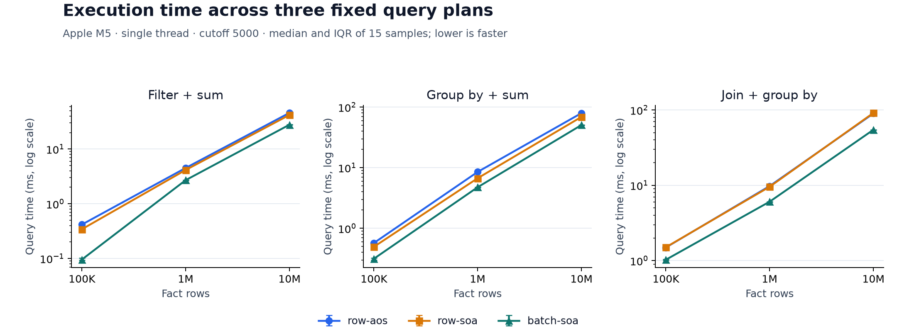
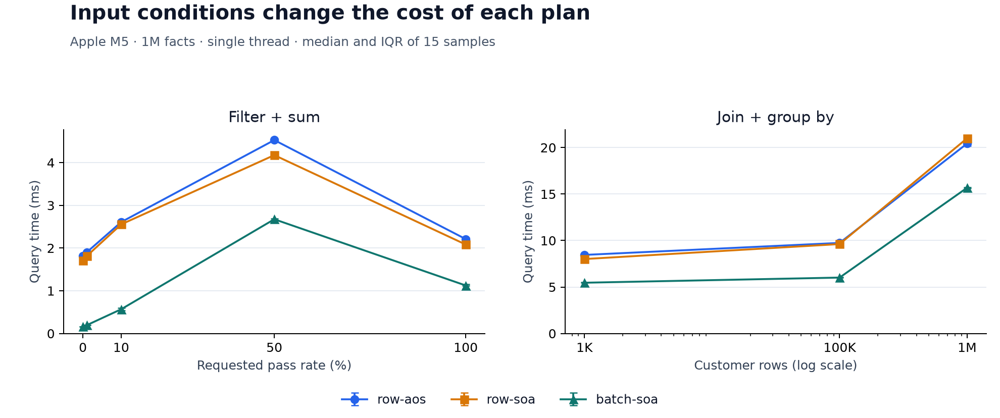
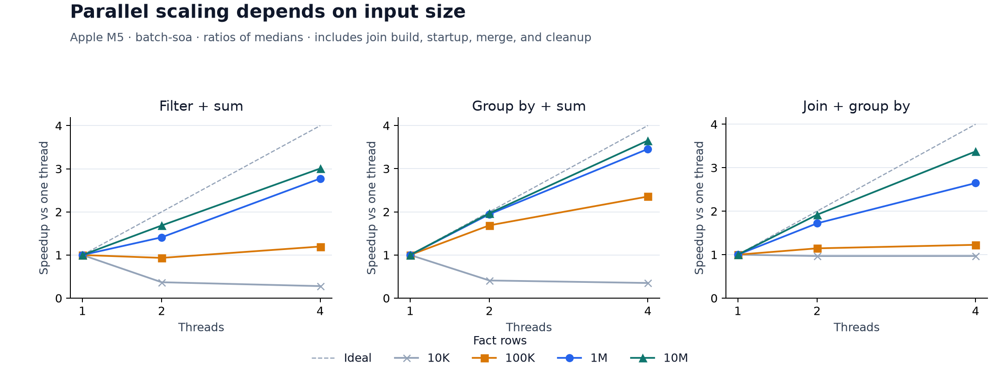
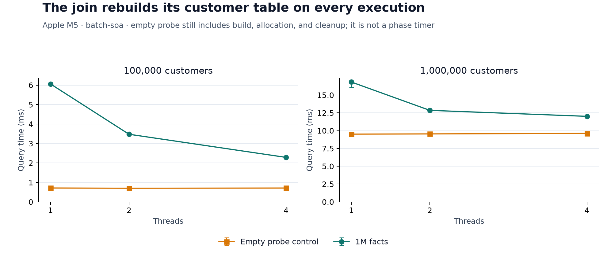

# Performance results: Apple M5

VQuery's first study compares the three engines on one Apple M5 desktop. At one million facts, the batch engine was 1.41–1.58× faster than the column-oriented row engine for the default queries. Four workers helped large inputs but hurt small filter and aggregate inputs. A large, serial join build limited thread scaling.

The archive contains **201 complete runs and 3,015 measured samples**. The engine revision is [`f0615a6`](https://github.com/Parkryan0128/vquery/commit/f0615a6c5d3c2f8f65741608b0ec9690d0a6c612); the report adds no engine optimization. [Raw data and manifests](../results/published/apple-m5-2026-10-14), [numerical analysis](figures/analysis.json), and [figure source](../scripts/plot_study.py) are checked in.

## Environment and method

| Setting | Value |
| --- | --- |
| CPU | Apple M5, 4 performance + 6 efficiency cores |
| Memory | 24 GiB |
| OS | macOS 26.6, ARM64 |
| Compiler | Apple Clang 17.0.0, clang-1700.3.19.1; libc++ headers 200100 |
| Build | Release, `-O3 -DNDEBUG`, no sanitizer, coverage, LTO, or PGO |
| Power and scheduling | AC power, low power mode off; OS scheduling without core pinning |
| Collection | 2026-10-14, 19:00–19:06 UTC; suites run sequentially |
| Default input | N=1M, cutoff=5000, groups=1024, M=100K, full join match, uniform keys, seed=42 |
| Batch / threads | B=2048, T=1 unless varied |
| Repetition | 3 warmups, 15 samples; calibrated K queries per sample for short runs |

Each configuration passed complete cross-engine result comparisons before timing. All timings include state allocation, serial join build, worker startup, merge, and intermediate cleanup. Input generation, checksums, sorting, output, and destruction of the returned result are outside the timer. Input remains resident across repetitions. The [benchmark protocol](benchmarking.md) defines the timer and validation in detail.

This was a working desktop, with applications left open. A preflight snapshot showed 93.92% aggregate CPU idle. Existing memory compression was present. The system counters recorded zero swap-ins/outs and 1,567 page-outs across collection; these are machine-wide counters, not per-query measurements. Thermal queries reported no warning, but temperatures and frequencies were not traced. The OS could schedule workers on either core type. These limits matter when interpreting small differences or reproducing absolute times. [Environment notes](../results/published/apple-m5-2026-10-14/study.json) preserve the collection conditions.

## Measurements collected

| Suite | Runs | Purpose |
| --- | ---: | --- |
| `core` | 27 | Three engines × three queries × 100K/1M/10M facts |
| `sensitivity` | 60 | Selectivity, group cardinality/skew, join size/match/skew, and six batch sizes; duplicate defaults removed |
| `parallel` | 9 | Three queries × 1/2/4 threads at 10M facts |
| `parallel-small` | 27 | The same thread sweep at 10K/100K/1M facts |
| `seed-checks` | 30 | Default queries and selected filter cutoffs with seeds 7 and 2026 |
| `join-build` | 12 | Empty versus 1M-row probes, M=100K/1M, and 1/2/4 threads |
| `core-repeat` | 27 | Same inputs, shuffled with schedule seed 2026 |
| `parallel-repeat` | 9 | Same inputs, shuffled with schedule seed 2026 |

Each run has 15 samples. The first core/parallel pass is primary; the repeat passes are retained separately and are not pooled or selected for their faster times. No samples were removed. Error bars show inclusive quartiles around the median, not confidence intervals. Speedups are ratios of matched-input medians.

## Row layout and batching

One million facts, one thread, default conditions; milliseconds:

| Query | `row-aos` | `row-soa` | `batch-soa` | Batch / row-SoA speedup |
| --- | ---: | ---: | ---: | ---: |
| Filter + sum | 4.512 | 4.146 | 2.702 | 1.53× |
| Group by + sum | 8.521 | 6.704 | 4.762 | 1.41× |
| Join + group by | 9.767 | 9.561 | 6.055 | 1.58× |



The row-SoA baseline keeps storage layout constant when comparing it with batch-SoA. Batching changes dispatch frequency, loop structure, and when values are loaded or copied. The experiment measures their combined effect, not a separate contribution from each. At the default cutoff, seeds 7 and 2026 also gave batch/row-SoA speedups of 1.53–1.54× for filtering, 1.41× for grouping, and 1.57–1.63× for joining.

## Finding 1: filter cost is not proportional to surviving rows

The initial hypothesis was that retaining more rows would steadily increase selection and aggregation work. The measured filter curve is not monotonic:

| Requested pass rate | `row-soa`, ms | `batch-soa`, ms |
| --- | ---: | ---: |
| 0% | 1.704 | 0.164 |
| 1% | 1.812 | 0.194 |
| 10% | 2.554 | 0.568 |
| 50% | 4.175 | 2.674 |
| 100% | 2.083 | 1.124 |



All-pass filtering was faster than 50% filtering despite retaining twice as many rows. The batch result repeated with seeds 7 and 2026: 50% took 2.680/2.710 ms, while all-pass took 1.142/1.064 ms. The generator preserves score and amount streams when changing the cutoff.

The [Clang remarks](../results/published/apple-m5-2026-10-14/diagnostics/compiler/operators.remarks.txt) report that the selection loop at `operators.cpp:134` was not loop-vectorized. Its [ARM64 assembly](../results/published/apple-m5-2026-10-14/diagnostics/compiler/operators.s) contains scalar comparisons, conditional branches, and unrolling. The batch filter's delayed stack sample put `FilterBatch::next` at the top of 2,172 of 2,561 samples. This identifies a useful optimization target and supports describing the implementation as batched execution; it does not establish a SIMD speedup.

Regular branch outcomes are a plausible contributor to the all-pass improvement. Branch-miss counters were not collected, so the report does not attribute a measured percentage to prediction or claim a cache cause. A branchless selection variant would be a separate implementation experiment.

## Finding 2: extra workers can make a query slower

At 10K facts, four workers achieved only 0.28× the single-thread filter throughput and 0.35× for grouped aggregation. The query pays for fresh workers, local buffers/state, joins, and merging on every execution. At that scale, the saved scan work did not repay the parallel path's overhead. More threads were an ineffective tuning choice.

At 10M facts, the balance changed:

| Query | 1 thread, ms | 4 threads, ms | Primary speedup | Repeat speedup | Primary efficiency |
| --- | ---: | ---: | ---: | ---: | ---: |
| Filter + sum | 27.929 | 9.291 | 3.01× | 2.75× | 75.1% |
| Group by + sum | 49.400 | 13.527 | 3.65× | 3.64× | 91.3% |
| Join + group by | 54.834 | 16.250 | 3.37× | 3.40× | 84.4% |



The crossover depends on the query and machine. The 100K grouped single-thread run had high within-run variation, so its speedup is less stable than the large-input results. The filter's repeated four-thread median was 10.3% slower than the first pass; the repeated two-thread case also had high variation. Thread placement and background activity were not controlled well enough to assign a single cause.

## Finding 3: a large join build limits parallel speedup

With N=1M and M=100K, batch execution improved from 6.059 ms at one thread to 2.285 ms at four, a 2.65× speedup. With M=1M, it improved from 16.831 to 12.011 ms, only 1.40×.

The empty-probe control still builds the full customer hash table, then opens and closes an empty pipeline. At M=1M it took 9.513 ms at one thread and 9.616 ms at four. That cost remains because `execute` finishes the serial build before launching fact-range workers.



This control includes allocation, table build, empty aggregation, and cleanup; it is not an isolated build timer. Subtracting it from a full query would not yield an exact probe duration because cache and allocation conditions differ. It nevertheless demonstrates substantial work that extra probe workers cannot remove.

The capacity rule allocates 2,097,152 slots for one million customers. The key/value/occupancy buffers alone occupy 18 MiB. In the [large-join profile](../results/published/apple-m5-2026-10-14/diagnostics/profiles/large-join-batch-soa.txt), top-of-stack counts included 1,034 samples in `insert_unique` and 410 in `find_or_insert`, compared with 422 in `JoinBatch::next`. This agrees with the serial-build concern. It does not prove cache-miss saturation; hash-probe counters and PMU measurements remain uncollected.

## Memory

For one million facts, AoS input uses 22.89 MiB and SoA uses 19.07 MiB: 24-byte padded rows versus 20 bytes across the four columns. A 100K-customer dimension adds 0.76 MiB to either layout.

| Query, one thread | Row-SoA query peak | Batch-SoA query peak |
| --- | ---: | ---: |
| Filter + sum | 24 bytes | 8,192 bytes |
| Group by + sum | 0.064 MiB | 0.069 MiB |
| Join + group by | 2.271 MiB | 2.302 MiB |

Batching's selection and join buffers add workspace even when query time improves. Parallel workers also hold local aggregate states. Managed peaks count requested buffer capacities and overlapping allocations. Process RSS is recorded separately and is a cumulative process high-water mark; neither measure alone describes cache residency.

## Repeatability and limits

Four runs exceeded the predefined 10% IQR/median threshold:

| Run | Configuration | IQR / median |
| --- | --- | ---: |
| `core/0000` | Row-AoS filter, 100K facts | 10.21% |
| `parallel-small/0012` | Batch group, 100K facts, one thread | 17.05% |
| `seed-checks/0010` | Batch filter, 1M facts, 10% pass, seed 7 | 13.23% |
| `parallel-repeat/0001` | Batch filter, 10M facts, two threads | 20.05% |

They remain in the archive and figures. Across separate passes, core medians changed by −9.33% to +2.35%; parallel medians changed by −13.21% to +10.30%. Small performance differences should not be treated as stable rankings on this host. Repeated samples share input and system state; IQR is dispersion, not an uncertainty bound on every future execution.

These are generated integer workloads on one memory-resident engine. They do not compare VQuery with a production database, cover disk execution, or establish Linux/x86 performance. The original Linux study plan was narrowed to a completed macOS case study using available hardware. Linux replication, explicit SIMD variants, branch/cache counters, hash-probe instrumentation, and persistent worker pools are possible follow-ups, not claims made by this release.

## Reproduce the measurements

Use a clean checkout and the [build requirements](../README.md#build). The archived manifests are the exact study inputs. This command runs all suites sequentially and creates new output directories:

```bash
study=results/published/apple-m5-2026-10-14
out=results/local/repeat-study
mkdir -p "$out"
cp -R "$study/manifests" "$out/"
for suite in core sensitivity parallel parallel-small seed-checks join-build core-repeat parallel-repeat; do
  python3 scripts/run_bench.py --manifest "$out/manifests/$suite.json" \
    --output-dir "$out/$suite" || break
done
```

The runner configures/tests Release and records the actual revision, compiler, binary hashes, environment, and complete-output controls. Match the recorded toolchain and engine revision for a close replication; a different machine or compiler is a new study. Record power, background load, and scheduling conditions alongside new results. Do not overwrite or pool them into the archived study.

Regenerate figures and validate the published runs without rerunning measurements:

```bash
python3 -m venv build/plot-env
build/plot-env/bin/python -m pip install -r scripts/requirements-plot.txt
build/plot-env/bin/python scripts/plot_study.py \
  --input-dir results/published/apple-m5-2026-10-14 --output-dir build/report-check
```

The plot script revalidates every raw run, checks the expected run counts and common source/build/host identities, and computes quartiles, speedups, efficiency, and repeat drift. It writes four PNG/SVG figures and `analysis.json`. CI regenerates the report and compares the numerical analysis with the checked-in copy. To plot a new study, change `--input-dir` to its directory containing the eight suites and copied `manifests/`.

## Reproduce the diagnostics

Compiler diagnostics are separate from timing. With a Clang Release build configured:

```bash
python3 scripts/compiler_report.py --build-dir build/release \
  --output-dir results/local/compiler-diagnostics
```

The helper reads the actual compile commands, emits loop-vectorization remarks and assembly for the execution sources, and leaves the timed binaries untouched. Commands and output for this study are in [diagnostics/compiler](../results/published/apple-m5-2026-10-14/diagnostics/compiler).

Three macOS `sample` recordings are stored in [diagnostics/profiles](../results/published/apple-m5-2026-10-14/diagnostics/profiles), with exact benchmark arguments. Each attached two seconds after launch and sampled for three seconds at a requested 1 ms interval. For example, on macOS with a fresh output name:

```bash
./build/release/vquery_bench --query filter-sum --engine batch-soa \
  --rows 1000000 --cutoff 5000 --warmup 3 --repetitions 75 \
  --output results/local/profile-filter.jsonl &
vquery_profile_pid=$!
sleep 2
sample "$vquery_profile_pid" 3 1 -file results/local/profile-filter.txt
wait "$vquery_profile_pid"
```

These are whole-process stack snapshots with delayed attachment. They can include allocation, result checks, output, or other work outside the query timer; the two-second delay is not a programmatic execution-phase boundary. Sample counts are not execution-only time percentages. Profiled timings were excluded from the 201 primary study runs. No hardware-counter or CPU-cycle claim is inferred from the stack samples.
